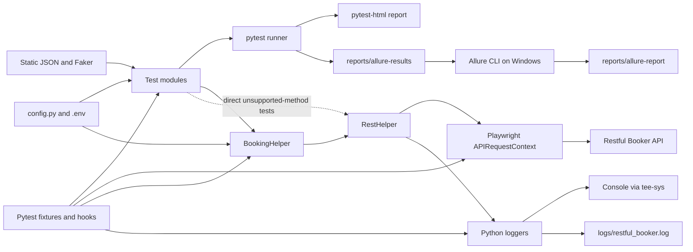
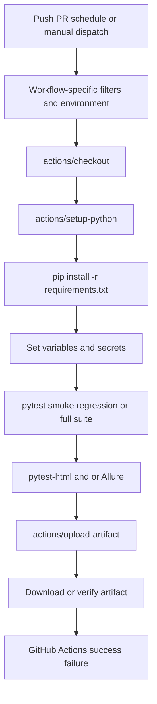

# Restful Booker API Automation Framework

Automated API validation for the Restful Booker service using Python,
Playwright synchronous `APIRequestContext`, pytest, pytest-html, and Allure.

[](https://www.python.org/)
[](https://docs.pytest.org/)
[](https://playwright.dev/python/)
[](https://github.com/features/actions)

> **Implementation scope:** the repository uses Playwright Python
> `APIRequestContext` for API requests. It is not browser UI automation and
> does not use the Python `requests` package.

## Table of Contents

- [Project Introduction](#project-introduction)
- [Project Highlights](#project-highlights)
- [Technology Stack](#technology-stack)
- [Project Architecture](#project-architecture)
- [Framework Architecture Diagram](#framework-architecture-diagram)
- [Framework Implementation Details](#framework-implementation-details)
- [API Endpoints Covered](#api-endpoints-covered)
- [Test Coverage](#test-coverage)
- [Test Execution Results](#test-execution-results)
- [Installation and Setup](#installation-and-setup)
- [Environment Variables and GitHub Secrets](#environment-variables-and-github-secrets)
- [Test Execution Commands](#test-execution-commands)
- [Logging and Reporting](#logging-and-reporting)
- [GitHub Actions CI/CD Integration](#github-actions-cicd-integration)
- [CI/CD Execution Evidence](#cicd-execution-evidence)
- [End-to-End Execution Flow](#end-to-end-execution-flow)
- [Security and Best Practices](#security-and-best-practices)
- [Challenges and Technical Learnings](#challenges-and-technical-learnings)
- [Future Enhancements](#future-enhancements)
- [Author](#author)

## Project Introduction

This framework automates validation of the public Restful Booker API. It tests
authentication, booking CRUD operations, filters, headers, update behavior,
negative inputs, and multi-step booking lifecycles.

The objectives are to:

- verify API status codes and response payloads;
- retain dynamic booking state across chained API calls;
- isolate setup and cleanup for booking tests;
- provide readable pytest, HTML, Allure, console, and file-based diagnostics;
- exercise the suite through GitHub-hosted runners, pull requests, schedules,
  and manual triggers.

Pytest discovers and executes tests. Fixtures create a function-scoped
Playwright API request context and helper objects. `BookingHelper` implements
domain operations, while `RestHelper` dispatches HTTP methods and logs requests
and responses.

## Project Highlights

- Playwright synchronous `APIRequestContext` API testing.
- pytest fixtures, parametrization, markers, logging hooks, and explicit
  assertions.
- Low-level `RestHelper` and domain-level `BookingHelper`.
- Static booking JSON plus Faker and standard-library dynamic generators.
- Authentication token and cookie authorization scenarios.
- Positive, negative, boundary, security, CRUD, and end-to-end scenarios.
- API chaining and data-integrity checks across bookings.
- pytest-html reports and Allure result collection.
- Windows Allure HTML generation hook when the Allure CLI is installed.
- Scheduled, push, pull-request, and manual GitHub Actions workflows.
- Matrix execution and smoke/regression job patterns in implemented workflows.

## Technology Stack

| Technology | Verified version/configuration | Purpose |
|---|---|---|
| Python | 3.11.8 locally | Framework and test implementation |
| pytest | 9.0.3 locally | Test discovery, fixtures, parametrization, assertions, reports |
| Playwright for Python | 1.64.1 locally | Synchronous API requests through `APIRequestContext` |
| pytest-playwright | 0.10.0 locally | Supplies the Playwright pytest fixture |
| pytest-html | 4.2.0 locally | Self-contained HTML report |
| allure-pytest | 2.16.2 locally | Writes Allure result files |
| Faker | 40.54.0 locally | Generates names and dates |
| python-dotenv | 1.2.4 locally | Loads local `.env` values |
| pytest-order | 1.5.0 locally | Declared test-order metadata |
| jsonschema | 4.26.0 locally | Declared dependency; not imported by current tests |
| GitHub Actions | Workflow syntax in this repository | CI/CD execution |
| Allure CLI | Not installed by Python requirements | Optional HTML report rendering |
| Git | N/A | Version control |

## Project Architecture

```text
restful-booker-api-automation/
├── config/
│   └── config.py
├── test_data/
│   └── booking_data.json
├── tests/
│   ├── conftest.py
│   ├── test_auth.py
│   ├── test_create_booking.py
│   ├── test_delete_booking.py
│   ├── test_e2e_scenarios.py
│   ├── test_get_all_bookings.py
│   ├── test_get_booking_by_id.py
│   ├── test_partial_update_booking.py
│   ├── test_ping_check.py
│   └── test_update_booking.py
├── utils/
│   ├── booking_helper.py
│   ├── data_generator.py
│   ├── logger.py
│   └── rest_helper.py
├── .github/
│   └── workflows/
│       └── 18 workflow YAML files
├── .gitignore
├── pytest.ini
├── requirements.txt
├── GitHub_Actions_Commands_Cheat_Sheet.md
└── README.md
```

| Path | Responsibility |
|---|---|
| `config/config.py` | Loads required environment variables, builds endpoint URLs, and defines ping performance thresholds. |
| `test_data/booking_data.json` | Baseline booking payload. |
| `tests/conftest.py` | Playwright fixture lifecycle, helper fixtures, log-report hooks, Allure cleanup, and Windows Allure generation. |
| `tests/test_auth.py` | Authentication tokens, credential combinations, token reuse, and authorization behavior. |
| `tests/test_create_booking.py` | Creation payloads, values, headers, boundary cases, and cleanup. |
| `tests/test_delete_booking.py` | Valid/invalid deletion, authorization, and post-delete state. |
| `tests/test_e2e_scenarios.py` | Multi-step create/retrieve/update/delete and token-reuse scenarios. |
| `tests/test_get_all_bookings.py` | Collection retrieval, query filters, malformed values, and unsupported methods. |
| `tests/test_get_booking_by_id.py` | Retrieval, response shape/types, ID formats, headers, and methods. |
| `tests/test_partial_update_booking.py` | PATCH behavior, field updates, payloads, authorization, and cleanup. |
| `tests/test_ping_check.py` | Availability, repeated calls, timing thresholds, and unsupported methods. |
| `tests/test_update_booking.py` | PUT replacement, authorization, payload edge cases, and data isolation. |
| `utils/rest_helper.py` | HTTP dispatch, logging, JSON parsing, and Playwright error translation. |
| `utils/booking_helper.py` | High-level auth, collection, booking, update, delete, and ping operations. |
| `utils/data_generator.py` | Loads static JSON and creates dynamic names, dates, prices, flags, and needs. |
| `utils/logger.py` | Console and file logger configuration. |
| `pytest.ini` | Discovery, capture, HTML/Allure options, logging, and marker definitions. |
| `requirements.txt` | Python dependency declarations. |
| `.gitignore` | Excludes `.env`, virtual environments, caches, reports, logs, and Allure output. |

## Framework Architecture Diagram



## Framework Implementation Details

### Request helper

`RestHelper.execute()` validates the HTTP method and endpoint, resolves query
parameters for log text, serializes a request body for logging, and dispatches
GET, POST, PUT, PATCH, DELETE, HEAD, or OPTIONS. `PlaywrightError`,
`TimeoutError`, connection, OS, and general exceptions are logged and converted
to a meaningful `RuntimeError`. `parse_response_json()` requires a JSON object.

### Booking helper

`BookingHelper` constructs configured endpoints and exposes methods for token
creation, collection retrieval, booking retrieval/creation, PUT/PATCH updates,
deletion, generic supported booking operations, and ping checks. Cookie
authentication is implemented by adding `Cookie: token=<value>`.

### Fixtures and lifecycle

`request_context` creates a Playwright API context for each test function and
disposes it afterward. `rest_helper` and `booking_helper` are function-scoped
fixtures. Individual test modules add fixtures for created-booking setup,
cleanup, and authenticated bookings. Cleanup is test-specific and is not a
single framework-wide cleanup policy.

### Configuration

`config/config.py` calls `load_dotenv()`, reads `BASE_URL`,
`BOOKER_USERNAME`, and `BOOKER_PASSWORD`, and raises `EnvironmentError` listing
missing variables. Endpoint constants are built from `BASE_URL`. Ping thresholds
are `PERF_P95_MS=2000` and `PERF_MAX_MS=5000`.

### Test data and parametrization

The baseline payload is `test_data/booking_data.json`. Dynamic values are
generated with Faker or `random`. Test functions use `pytest.parametrize` for
invalid credentials, IDs, headers, values, HTTP methods, and query filters.

### Assertions and response validation

Tests assert statuses, response fields, JSON types, persisted state, cookie
handling, and the independence of unrelated bookings. The suite does not
currently call `jsonschema` even though it is declared.

### Logging and teardown

Pytest hooks log start, PASS, FAIL, and SKIP events. Request and response
payloads are currently written to console and file logs without redaction.
Booking fixtures delete tracked records where implemented.

## API Endpoints Covered

| Method | Endpoint | Purpose | Related test module |
|---|---|---|---|
| POST | `/auth` | Create a token; validate credentials and authorization behavior. | `test_auth.py` |
| GET | `/ping` | Check availability and timing. | `test_ping_check.py` |
| GET | `/booking` | Retrieve IDs and exercise name/date filters. | `test_get_all_bookings.py` |
| POST | `/booking` | Create a booking. | `test_create_booking.py`, `test_e2e_scenarios.py` |
| GET | `/booking/{id}` | Retrieve one booking and validate shape/types. | `test_get_booking_by_id.py`, lifecycle modules |
| PUT | `/booking/{id}` | Replace booking data. | `test_update_booking.py`, `test_e2e_scenarios.py` |
| PATCH | `/booking/{id}` | Partially update booking data. | `test_partial_update_booking.py` |
| DELETE | `/booking/{id}` | Delete a booking. | `test_delete_booking.py`, lifecycle modules |

The suite also sends HEAD and OPTIONS to booking/booking-ID/ping paths and
parametrized unsupported methods to collection endpoints.

## Test Coverage

- **Authentication:** valid and invalid credentials, missing fields, malformed
  payloads, token reuse, and repeated token creation.
- **Authorization:** missing, invalid, alternate, and valid cookie tokens on
  protected operations.
- **Positive testing:** valid booking creation, retrieval, update, patch,
  deletion, and ping calls.
- **Negative testing:** malformed JSON, missing fields, invalid IDs,
  unsupported methods, invalid credentials, and invalid query values.
- **Boundary testing:** numeric, string, date, and header-value boundaries.
- **CRUD:** create, list, retrieve, full update, partial update, and delete.
- **Response validation:** HTTP status, JSON field presence, field types,
  headers, and error payload behavior.
- **Data integrity:** update/delete checks and independence of unrelated
  booking records.
- **API chaining:** create → retrieve → update → retrieve/delete.
- **End-to-end:** complete booking lifecycle and reuse of one token across
  multiple bookings.
- **Security-related:** authentication placement, invalid cookie values,
  SQL-injection/XSS-style filter values, and hostile payload text.
- **Reliability:** repeated ping and booking requests.
- **Performance/reliability checks:** response-time checks in
  `test_ping_check.py` use `PERF_P95_MS` and `PERF_MAX_MS`; this is a threshold
  check, not a load test.

No category count is reported because categories overlap and parametrized cases
expand into multiple collected instances.

## Test Execution Results

Verified collection on 2026-11-25 with the local Python 3.11.8 environment:

| Result | Count |
|---|---:|
| Collected | 232 |
| Passed | **Not verified** |
| Failed | **Not verified** |
| Skipped | **Not verified** |
| XFAIL | **Not verified** |
| Execution date | **Not verified** |

The repository has generated reports and an existing README previously
described a full-suite result, but no dated machine-readable run output or
workflow log is available to verify a current pass/fail summary. Update this
table after a complete run and retain the command and execution date.

## Installation and Setup

### Prerequisites

- Python 3.11 or newer is practical for the workflows; local verification used
  Python 3.11.8.
- Git.
- Network access to the configured Restful Booker environment.
- Optional Allure CLI and Java for HTML report generation on Windows.

### Clone and configure

```powershell
git clone https://github.com/hellojanardhan/restful-booker-api-automation.git
Set-Location .\restful-booker-api-automation

python -m venv .venv
.\.venv\Scripts\Activate.ps1

python -m pip install --upgrade pip
python -m pip install -r requirements.txt
```

Create `.env` in the repository root:

```dotenv
BASE_URL=https://restful-booker.herokuapp.com
BOOKER_USERNAME=replace_with_test_username
BOOKER_PASSWORD=replace_with_test_password
```

Command Prompt activation is also supported:

```bat
.venv\Scripts\activate.bat
```

## Environment Variables and GitHub Secrets

| Name | Type | Required | Purpose |
|---|---|---:|---|
| `BASE_URL` | Local environment or GitHub variable/secret | Yes | API root URL. |
| `BOOKER_USERNAME` | Local environment or GitHub secret | Yes | Authentication username. |
| `BOOKER_PASSWORD` | Local environment or GitHub secret | Yes | Authentication password. |

Local `.env` values are loaded with `python-dotenv`; `.env` is excluded by
`.gitignore`.

Workflows use repository secrets or variables:

- `secrets.BASE_URL`, `vars.BASE_URL`, or the public/default base URL, depending
  on the workflow.
- `secrets.BOOKER_USERNAME`
- `secrets.BOOKER_PASSWORD`

The workflows must have these values configured in repository or environment
settings. The `api-tests.yml`, PR, cron, report, and matrix workflows reference
`QA` or repository variables/secrets where shown. Never expose actual values in
workflow YAML or README text.

## Test Execution Commands

Run from the repository root.

```powershell
# Complete suite
python -m pytest

# Verbose suite
python -m pytest -v

# Module
python -m pytest .\tests\test_auth.py

# Individual test
python -m pytest .\tests\test_auth.py::test_create_auth_token

# Smoke
python -m pytest -m smoke -v

# Regression
python -m pytest -m regression -v

# Marker combination
python -m pytest -m "functional and booking_by_id" -v

# Keyword
python -m pytest -k "invalid_id" -v

# Collection only
python -m pytest --collect-only

# HTML report
python -m pytest -v --html=reports/report.html --self-contained-html

# Allure results
python -m pytest -v --alluredir=reports/allure-results

# Stop after the first failure
python -m pytest -x
```

## Logging and Reporting

### Python logging

`utils/logger.py` creates INFO-level named loggers with console and
`logs/restful_booker.log` handlers. The format includes timestamp, level,
logger name, and message. Pytest hooks print PASS, FAIL, and SKIP details.
`--capture=tee-sys` in `pytest.ini` sends captured output to the console and
HTML report.

### pytest-html

`pytest.ini` automatically creates `reports/report.html` as a self-contained
HTML report. Individual workflows also generate workflow-specific report names
such as `smoke-report.html`, `regression-report.html`, or `report.html`.

### Allure

Allure results are written to `reports/allure-results`. The session finish hook
attempts to generate `reports/allure-report` if `allure` or `allure.bat` is on
`PATH`. On Windows it invokes the bat file through `cmd.exe`. Java plus the
Allure CLI are required; `allure-pytest` alone only collects result files.

**Credential protection:** `RestHelper` logs request and response bodies
without redaction. Do not publish raw logs or reports containing test credentials.

## GitHub Actions CI/CD Integration

### Workflow summary

| Workflow | Trigger | Main purpose | Jobs | Reports/artifacts |
|---|---|---|---|---|
| `01_basic_workflow.yml` | Manual | Environment and runner smoke check | `manual_execution` | None |
| `02_event_triggers.yml` | Push/PR/manual | Trigger and setup demonstration | `event_triggers` | None |
| `03-python-pytest.yml` | Push/PR/manual | Install dependencies and run pytest | `pytest_tests` | pytest console/report defaults |
| `04-reports-artifacts.yml` | Push/PR/manual, filtered | Generate, upload, download, and verify pytest HTML | `reports_artifacts` | `pytest-html-report`, 10 days |
| `05-complete-ci-pipeline.yml` | Push/PR, filtered | Run smoke/regression and verify both reports | `ci-pipeline` | `pytest-html-report`, 7 days |
| `06-job-dependencies.yml` | Push/PR/manual, filtered | Dependency artifact plus parallel smoke/regression | `setup`, `smoke_tests`, `regression_tests`, `download_reports` | Dependency artifact; report artifacts, 7 days |
| `Day_04.yml` | Push/PR/manual | Run suite and upload HTML | `api_tests` | `pytest-html-report`, 7 days |
| `api-tests.yml` | Push/PR/manual | Full suite with pytest HTML and Allure | `api_tests` | `API-Automation-Test-Reports`, 7 days |
| `cron-job.yml` | Daily 20:30 UTC + manual | Regression suite | `regression_tests` | No upload |
| `cross_platform_api_tests.yml` | Push/PR | Matrix workflow cross-platform | `matrix_tests` | `API-Automation-Test-Reports`, 7 days |
| `day3-tests.yml` | Push/PR/manual | Parallel smoke and regression jobs | `smoke_tests`, `regression_tests` | None |
| `first-sample-run.yml` | Push/PR, filtered | Checkout and list test files | `test` | None |
| `full_API_automation_pipeline.yml` | Push/PR | Matrix display plus Ubuntu test execution | `matrix_tests` | `API-Automation-Test-Reports`, 7 days |
| `main.yml` | Push/PR/manual, filtered | Full suite, HTML verification/upload | `all_tests` | `pytest-html-report`, 7 days |
| `matrix-tests.yml` | Push/PR | Ubuntu full-suite matrix-labelled run | `matrix_tests` | `API-Automation-Test-Reports`, 7 days |
| `pr-validation.yml` | PR only | Smoke test and HTML report | `smoke_tests` | `smoke-test-report` |
| `python-matrix-strategy.yml` | Push/PR | 2 OS × 2 Python versions | `matrix_tests` | Per-combination reports, 7 days |
| `run-all-tests.yml` | Push/PR/manual | Full suite with hardcoded public URL and demo credentials | `all_tests` | `pytest-html-report`, 7 days |

### Individual workflows

1. **`01_basic_workflow.yml` — Basic Workflow:** manual `workflow_dispatch`,
   Ubuntu latest, Python 3.12, checkout, version check, working directory, and
   repository file listing. It does not install dependencies or run tests.

2. **`02_event_triggers.yml` — Event Triggers:** push/PR for `main` plus manual
   dispatch, with path filters on tests, pytest config, requirements, and this
   workflow. Ubuntu/Python 3.12 setup and dependency installation only.

3. **`03-python-pytest.yml` — Python Pytest CI Pipeline:** push/PR/manual,
   filtered for the test/config paths. Ubuntu, Python 3.12, requirements
   installation, then `pytest -v`. Job secrets supply all three API variables.

4. **`04-reports-artifacts.yml` — Pytest HTML Reports and Artifacts Pipeline:**
   push/PR/manual, filtered. Ubuntu/Python 3.12, full pytest run, HTML upload,
   download from the same run, and a non-empty report verification. Artifact:
   10-day retention.

5. **`05-complete-ci-pipeline.yml` — Complete CI Pipeline:** filtered push/PR.
   Smoke and regression reports run sequentially in one Ubuntu job. The
   regression step is tied to dependency-install success, and uploads/downloads
   both reports with `if: always()`. It fails report verification if either
   file is missing or empty.

6. **`06-job-dependencies.yml` — Job Dependencies and Parallel Execution:**
   setup downloads wheels and uploads a dependency artifact for 1 day. Smoke
   and regression jobs depend on setup and run in parallel from offline wheel
   installation. `download_reports` has both report jobs as dependencies and
   verifies non-empty downloaded HTML files. Reports retain 7 days.

7. **`Day_04.yml` — Reports/Artifacts/Secrets/Variables:** push/PR/manual,
   Ubuntu/Python 3.12, full suite, upload an HTML report. Uses repository
   variable `BASE_URL` and both credential secrets.

8. **`api-tests.yml` — Restful Booker Full API Automation Pipeline:** push/PR
   targets `main` plus manual dispatch. QA environment, Ubuntu/Python 3.12,
   Java, and Allure CLI installation. It runs full pytest with Allure and HTML
   options, verifies report paths, and uploads HTML plus Allure report.

9. **`cron-job.yml` — Nightly API Regression:** cron `30 20 * * *` (20:30 UTC)
   plus manual dispatch. QA environment, Ubuntu/Python 3.12, regression markers,
   with no report or artifact upload.

10. **`cross_platform_api_tests.yml` — Python Matrix Strategy:** push/PR,
    Ubuntu/Windows matrix with Python 3.11/3.12. It runs pytest and uploads
    reports. Its YAML and report paths should be validated in GitHub before
    relying on it because the file has unusual leading indentation.

11. **`day3-tests.yml` — Day 3 Smoke and Regression:** push/PR/manual, separate
    smoke and regression jobs on Ubuntu/Python 3.12. No artifact upload.

12. **`first-sample-run.yml` — First Sample Run:** filtered push/PR, Ubuntu,
    checkout and test-file listing; no Python setup or test execution.

13. **`full_API_automation_pipeline.yml` — Python Matrix strategy:** push/PR,
    matrix metadata for Python 3.10/3.11/3.12 but setup and execution are fixed
    to Python 3.12 on Ubuntu. Uploads HTML and Allure report paths. YAML
    indentation and actual Allure directory status should be validated.

14. **`main.yml` — Running all API tests:** filtered push/PR/manual, Ubuntu,
    Python 3.12, hardcoded public `BASE_URL`, credential secrets, full pytest,
    report checks, and 7-day HTML artifact.

15. **`matrix-tests.yml` — Python Matrix strategy:** push/PR, Ubuntu/Python
    3.12, full suite, HTML/Allure generation, artifact upload. The file declares
    no actual matrix variable despite its name.

16. **`pr-validation.yml` — PR Validation:** PR events on `main`, one QA
    Ubuntu/Python 3.12 smoke job. Generates HTML and uploads it; report
    generation continues on error.

17. **`python-matrix-strategy.yml` — Python Matrix Strategy – Cross-Platform
    API Tests:** push/PR, 4 matrix combinations: Ubuntu/Windows × Python
    3.11/3.12. `fail-fast: false`, QA environment, HTML/Allure results, and
    named per-combination artifacts for 7 days.

18. **`run-all-tests.yml` — Running all tests:** push/PR/manual, Ubuntu/Python
    3.12, full suite. Uses a literal public Restful Booker URL and literal demo
    credentials for test steps, and uploads `report.html` for 7 days.

### CI flow diagram



## CI/CD Execution Evidence

Recruiters and reviewers can inspect:

- workflow run history:
  [Actions](https://github.com/hellojanardhan/restful-booker-api-automation/actions);
- repository: [GitHub](https://github.com/hellojanardhan/restful-booker-api-automation);
- successful/failed job summaries and step logs inside each run;
- downloadable artifacts from workflows that upload reports;
- HTML report links inside artifact archives after downloading them;
- test output and failure tracebacks in run logs and pytest-html reports.

No screenshot or external report-hosting link is claimed because none is
committed or configured in this repository.

## End-to-End Execution Flow

For a workflow that runs the full suite:

1. A push/PR/schedule/manual event starts the selected workflow.
2. GitHub selects an Ubuntu or Windows runner and QA/repository environment
   settings where configured.
3. `actions/checkout` loads the repository.
4. `actions/setup-python` configures the workflow's Python version.
5. Requirements are installed.
6. Environment variables or secrets are mapped to process environment values.
7. pytest discovers `tests/test_*.py`, creates fixtures, and executes markers or
   the complete suite.
8. Helpers call Restful Booker through Playwright and tests validate state.
9. pytest-html and/or Allure collect report data.
10. The workflow verifies, uploads, downloads, or displays reports as configured.
11. GitHub records the workflow result.

## Security and Best Practices

### Implemented

- `.env` is excluded from Git.
- Credentials are read from environment variables.
- GitHub workflows can use repository secrets and variables.
- Authentication uses test credentials and generated booking tokens.
- Booking cleanup is implemented in selected fixtures and lifecycle tests.
- Allure result directories are cleaned before a local test session.

### Improvement areas

- `RestHelper` logs request and response bodies, including possible credentials
  or tokens. Add redaction before logs or reports are shared.
- Hardcoded demo credentials exist in `run-all-tests.yml`; replace them with
  repository secrets consistently.
- Several workflows use a mix of variables and secrets for `BASE_URL`; standardize
  on one configuration source.
- Validate malformed YAML in the two indented matrix files and inconsistent
  Allure report paths before publishing workflows as examples.
- Add timeout and retry configuration if network reliability becomes a test
  requirement.
- Document exact repository environment settings when they are created.
- Remove or separate generated local reports/logs from public snapshots.

## Challenges and Technical Learnings

The repository structure itself demonstrates several test concerns:

- **Authentication:** tests generate a token and pass it through a cookie rather
  than an authorization header.
- **Dynamic data:** Faker and random generators create names, dates, prices,
  flags, and additional-needs values.
- **API chaining:** lifecycle tests depend on IDs and token values produced by
  earlier calls.
- **Fixture lifecycle:** request contexts must be created and disposed per
  test; booking fixtures must clean records.
- **Test isolation:** tests create or track records and verify that updates/deletes
  do not affect unrelated bookings.
- **Negative behavior:** invalid data and unsupported HTTP methods require
  status-based assertions instead of assumptions.
- **CI environment:** credentials and URLs must be configured consistently
  across GitHub runners.
- **Reporting:** pytest-html works as a Python plugin, while Allure HTML requires
  a separate CLI and Java.
- **Debugging:** console/file logs and report tracebacks provide failure context,
  but must be redacted before publication.

## Future Enhancements

The following are not verified as implemented:

- Confirmed, dated full-suite execution reporting in this README.
- GitHub Pages or another public report-hosting step.
- Centralized redaction middleware for credentials and tokens.
- Configurable HTTP timeout/retry settings.
- Shared JSON-schema validation using `jsonschema`.
- A single canonical CI pipeline instead of multiple learning workflows.
- Reusable workflow/composite action extraction.
- Test-data isolation and database-style cleanup for highly parallel runs.
- Explicit coverage dashboard and category counts.
- Dependency caching and more consistent matrix setup.

## Author

**hellojanardhan** · [GitHub profile](https://github.com/hellojanardhan)
