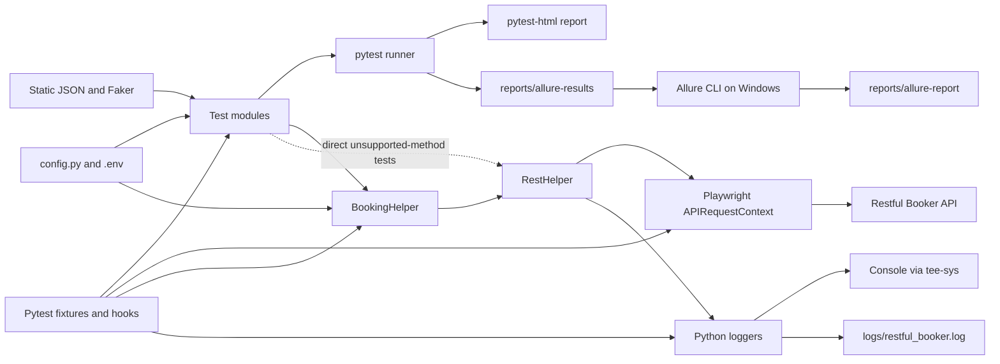
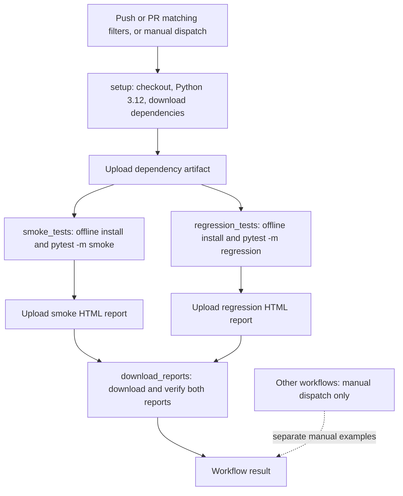

# Restful Booker API Automation Framework

Automated API validation for the Restful Booker service using Python,
Playwright synchronous `APIRequestContext`, pytest, pytest-html, and Allure.

[](https://www.python.org/)
[](https://docs.pytest.org/)
[](https://playwright.dev/python/)
[](https://github.com/features/actions)

> **Implementation scope:** the repository uses Playwright Python
> `APIRequestContext` for API requests. It is not browser UI automation and
> does not use the Python `requests` package.

## Table of Contents

- [Project Introduction](#project-introduction)
- [Project Highlights](#project-highlights)
- [Technology Stack](#technology-stack)
- [Project Architecture](#project-architecture)
- [Framework Architecture Diagram](#framework-architecture-diagram)
- [Framework Implementation Details](#framework-implementation-details)
- [API Endpoints Covered](#api-endpoints-covered)
- [Test Coverage](#test-coverage)
- [Test Execution Results](#test-execution-results)
- [Installation and Setup](#installation-and-setup)
- [Environment Variables and GitHub Secrets](#environment-variables-and-github-secrets)
- [Test Execution Commands](#test-execution-commands)
- [Logging and Reporting](#logging-and-reporting)
- [GitHub Actions CI/CD Integration](#github-actions-cicd-integration)
- [CI/CD Execution Evidence](#cicd-execution-evidence)
- [End-to-End Execution Flow](#end-to-end-execution-flow)
- [Security and Best Practices](#security-and-best-practices)
- [Challenges and Technical Learnings](#challenges-and-technical-learnings)
- [Future Enhancements](#future-enhancements)
- [Author](#author)

## Project Introduction

This framework automates validation of the public Restful Booker API. It tests
authentication, booking CRUD operations, filters, headers, update behavior,
negative inputs, and multi-step booking lifecycles.

The objectives are to:

- verify API status codes and response payloads;
- retain dynamic booking state across chained API calls;
- isolate setup and cleanup for booking tests;
- provide readable pytest, HTML, Allure, console, and file-based diagnostics;
- exercise the suite on GitHub-hosted runners through one push/PR workflow and
  optional manual workflow examples.

Pytest discovers and executes tests. Fixtures create a function-scoped
Playwright API request context and helper objects. `BookingHelper` implements
domain operations, while `RestHelper` dispatches HTTP methods and logs requests
and responses.

## Project Highlights

- Playwright synchronous `APIRequestContext` API testing.
- pytest fixtures, parametrization, markers, logging hooks, and explicit
  assertions.
- Low-level `RestHelper` and domain-level `BookingHelper`.
- Static booking JSON plus Faker and standard-library dynamic generators.
- Authentication token and cookie authorization scenarios.
- Positive, negative, boundary, security, CRUD, and end-to-end scenarios.
- API chaining and data-integrity checks across bookings.
- pytest-html reports and Allure result collection.
- Windows Allure HTML generation hook when the Allure CLI is installed.
- One push/PR/manual primary workflow with separate smoke and regression jobs.
- Manual-only workflow examples for reporting, event handling, matrices, and
  job dependencies.

## Technology Stack

| Technology | Verified version/configuration | Purpose |
|---|---|---|
| Python | 3.11.8 locally | Framework and test implementation |
| pytest | 9.0.3 locally | Test discovery, fixtures, parametrization, assertions, reports |
| Playwright for Python | 1.64.1 locally | Synchronous API requests through `APIRequestContext` |
| pytest-playwright | 0.10.0 locally | Supplies the Playwright pytest fixture |
| pytest-html | 4.2.0 locally | Self-contained HTML report |
| allure-pytest | 2.16.2 locally | Writes Allure result files |
| Faker | 40.54.0 locally | Generates names and dates |
| python-dotenv | 1.2.4 locally | Loads local `.env` values |
| pytest-order | 1.5.0 locally | Declared test-order metadata |
| jsonschema | 4.26.0 locally | Declared dependency; not imported by current tests |
| GitHub Actions | Workflow syntax in this repository | CI/CD execution |
| Allure CLI | Not installed by Python requirements | Optional HTML report rendering |
| Git | N/A | Version control |

## Project Architecture

```text
restful-booker-api-automation/
├── config/
│   └── config.py
├── test_data/
│   └── booking_data.json
├── tests/
│   ├── conftest.py
│   ├── test_auth.py
│   ├── test_create_booking.py
│   ├── test_delete_booking.py
│   ├── test_e2e_scenarios.py
│   ├── test_get_all_bookings.py
│   ├── test_get_booking_by_id.py
│   ├── test_partial_update_booking.py
│   ├── test_ping_check.py
│   └── test_update_booking.py
├── utils/
│   ├── booking_helper.py
│   ├── data_generator.py
│   ├── logger.py
│   └── rest_helper.py
├── .github/
│   └── workflows/
│       └── 18 workflow YAML files
├── .gitignore
├── pytest.ini
├── requirements.txt
├── GitHub_Actions_Commands_Cheat_Sheet.md
└── README.md
```

| Path | Responsibility |
|---|---|
| `config/config.py` | Loads required environment variables, builds endpoint URLs, and defines ping performance thresholds. |
| `test_data/booking_data.json` | Baseline booking payload. |
| `tests/conftest.py` | Playwright fixture lifecycle, helper fixtures, log-report hooks, Allure cleanup, and Windows Allure generation. |
| `tests/test_auth.py` | Authentication tokens, credential combinations, token reuse, and authorization behavior. |
| `tests/test_create_booking.py` | Creation payloads, values, headers, boundary cases, and cleanup. |
| `tests/test_delete_booking.py` | Valid/invalid deletion, authorization, and post-delete state. |
| `tests/test_e2e_scenarios.py` | Multi-step create/retrieve/update/delete and token-reuse scenarios. |
| `tests/test_get_all_bookings.py` | Collection retrieval, query filters, malformed values, and unsupported methods. |
| `tests/test_get_booking_by_id.py` | Retrieval, response shape/types, ID formats, headers, and methods. |
| `tests/test_partial_update_booking.py` | PATCH behavior, field updates, payloads, authorization, and cleanup. |
| `tests/test_ping_check.py` | Availability, repeated calls, timing thresholds, and unsupported methods. |
| `tests/test_update_booking.py` | PUT replacement, authorization, payload edge cases, and data isolation. |
| `utils/rest_helper.py` | HTTP dispatch, logging, JSON parsing, and Playwright error translation. |
| `utils/booking_helper.py` | High-level auth, collection, booking, update, delete, and ping operations. |
| `utils/data_generator.py` | Loads static JSON and creates dynamic names, dates, prices, flags, and needs. |
| `utils/logger.py` | Console and file logger configuration. |
| `pytest.ini` | Discovery, capture, HTML/Allure options, logging, and marker definitions. |
| `requirements.txt` | Python dependency declarations. |
| `.gitignore` | Excludes `.env`, virtual environments, caches, reports, logs, and Allure output. |

## Framework Architecture Diagram



## Framework Implementation Details

### Request helper

`RestHelper.execute()` validates the HTTP method and endpoint, resolves query
parameters for log text, serializes a request body for logging, and dispatches
GET, POST, PUT, PATCH, DELETE, HEAD, or OPTIONS. `PlaywrightError`,
`TimeoutError`, connection, OS, and general exceptions are logged and converted
to a meaningful `RuntimeError`. `parse_response_json()` requires a JSON object.

### Booking helper

`BookingHelper` constructs configured endpoints and exposes methods for token
creation, collection retrieval, booking retrieval/creation, PUT/PATCH updates,
deletion, generic supported booking operations, and ping checks. Cookie
authentication is implemented by adding `Cookie: token=<value>`.

### Fixtures and lifecycle

`request_context` creates a Playwright API context for each test function and
disposes it afterward. `rest_helper` and `booking_helper` are function-scoped
fixtures. Individual test modules add fixtures for created-booking setup,
cleanup, and authenticated bookings. Cleanup is test-specific and is not a
single framework-wide cleanup policy.

### Configuration

`config/config.py` calls `load_dotenv()`, reads `BASE_URL`,
`BOOKER_USERNAME`, and `BOOKER_PASSWORD`, and raises `EnvironmentError` listing
missing variables. Endpoint constants are built from `BASE_URL`. Ping thresholds
are `PERF_P95_MS=2000` and `PERF_MAX_MS=5000`.

### Test data and parametrization

The baseline payload is `test_data/booking_data.json`. Dynamic values are
generated with Faker or `random`. Tests use the `@pytest.mark.parametrize`
decorator for invalid credentials, IDs, headers, values, HTTP methods, and
query filters.

### Assertions and response validation

Tests assert statuses, response fields, JSON types, persisted state, cookie
handling, and the independence of unrelated bookings. The suite does not
currently call `jsonschema` even though it is declared.

### Logging and teardown

Pytest hooks log start, PASS, FAIL, and SKIP events. Request and response
payloads are currently written to console and file logs without redaction.
Booking fixtures delete tracked records where implemented.

## API Endpoints Covered

| Method | Endpoint | Purpose | Related test module |
|---|---|---|---|
| POST | `/auth` | Create a token; validate credentials and authorization behavior. | `test_auth.py` |
| GET | `/ping` | Check availability and timing. | `test_ping_check.py` |
| GET | `/booking` | Retrieve IDs and exercise name/date filters. | `test_get_all_bookings.py` |
| POST | `/booking` | Create a booking. | `test_create_booking.py`, `test_e2e_scenarios.py` |
| GET | `/booking/{id}` | Retrieve one booking and validate shape/types. | `test_get_booking_by_id.py`, lifecycle modules |
| PUT | `/booking/{id}` | Replace booking data. | `test_update_booking.py`, `test_e2e_scenarios.py` |
| PATCH | `/booking/{id}` | Partially update booking data. | `test_partial_update_booking.py` |
| DELETE | `/booking/{id}` | Delete a booking. | `test_delete_booking.py`, lifecycle modules |

The suite also sends HEAD and OPTIONS to booking/booking-ID/ping paths and
parametrized unsupported methods to collection endpoints.

## Test Coverage

- **Authentication:** valid and invalid credentials, missing fields, malformed
  payloads, token reuse, and repeated token creation.
- **Authorization:** missing, invalid, alternate, and valid cookie tokens on
  protected operations.
- **Positive testing:** valid booking creation, retrieval, update, patch,
  deletion, and ping calls.
- **Negative testing:** malformed JSON, missing fields, invalid IDs,
  unsupported methods, invalid credentials, and invalid query values.
- **Boundary testing:** numeric, string, date, and header-value boundaries.
- **CRUD:** create, list, retrieve, full update, partial update, and delete.
- **Response validation:** HTTP status, JSON field presence, field types,
  headers, and error payload behavior.
- **Data integrity:** update/delete checks and independence of unrelated
  booking records.
- **API chaining:** create → retrieve → update → retrieve/delete.
- **End-to-end:** complete booking lifecycle and reuse of one token across
  multiple bookings.
- **Security-related:** authentication placement, invalid cookie values,
  SQL-injection/XSS-style filter values, and hostile payload text.
- **Reliability:** repeated ping and booking requests.
- **Performance/reliability checks:** response-time checks in
  `test_ping_check.py` use `PERF_P95_MS` and `PERF_MAX_MS`; this is a threshold
  check, not a load test.

No category count is reported because categories overlap and parametrized cases
expand into multiple collected instances.

## Test Execution Results

Verified collection on 2026-11-25 with the local Python 3.11.8 environment:

| Result | Count |
|---|---:|
| Collected | 232 |
| Passed | **Not verified** |
| Failed | **Not verified** |
| Skipped | **Not verified** |
| XFAIL | **Not verified** |
| Execution date | **Not verified** |

The repository has generated reports and an existing README previously
described a full-suite result, but no dated machine-readable run output or
workflow log is available to verify a current pass/fail summary. Update this
table after a complete run and retain the command and execution date.

## Installation and Setup

### Prerequisites

- Python 3.10, 3.11, and 3.12 appear in the manual workflow examples. Local
  verification used Python 3.11.8; compatibility across every listed version
  has not been verified.
- Git.
- Network access to the configured Restful Booker environment.
- Optional Allure CLI and Java for HTML report generation on Windows.

### Clone and configure

```powershell
git clone https://github.com/hellojanardhan/restful-booker-api-automation.git
Set-Location .\restful-booker-api-automation

python -m venv .venv
.\.venv\Scripts\Activate.ps1

python -m pip install --upgrade pip
python -m pip install -r requirements.txt
```

Create `.env` in the repository root:

```dotenv
BASE_URL=https://restful-booker.herokuapp.com
BOOKER_USERNAME=replace_with_test_username
BOOKER_PASSWORD=replace_with_test_password
```

Command Prompt activation is also supported:

```bat
.venv\Scripts\activate.bat
```

## Environment Variables and GitHub Secrets

| Name | Type | Required | Purpose |
|---|---|---:|---|
| `BASE_URL` | Local environment or GitHub variable/secret | Yes | API root URL. |
| `BOOKER_USERNAME` | Local environment or GitHub secret | Yes | Authentication username. |
| `BOOKER_PASSWORD` | Local environment or GitHub secret | Yes | Authentication password. |

Local `.env` values are loaded with `python-dotenv`; `.env` is excluded by
`.gitignore`.

Workflows use repository secrets or variables:

- `secrets.BASE_URL`, `vars.BASE_URL`, or the public/default base URL, depending
  on the workflow.
- `secrets.BOOKER_USERNAME`
- `secrets.BOOKER_PASSWORD`

The workflows must have these values configured in repository or environment
settings. The `api-tests.yml`, PR, cron, report, and matrix workflows reference
`QA` or repository variables/secrets where shown. Never expose actual values in
workflow YAML or README text.

## Test Execution Commands

Run from the repository root.

```powershell
# Complete suite
python -m pytest

# Verbose suite
python -m pytest -v

# Module
python -m pytest .\tests\test_auth.py

# Individual test
python -m pytest .\tests\test_auth.py::test_create_auth_token

# Smoke
python -m pytest -m smoke -v

# Regression
python -m pytest -m regression -v

# Marker combination
python -m pytest -m "functional and booking_by_id" -v

# Keyword
python -m pytest -k "invalid_id" -v

# Collection only
python -m pytest --collect-only

# HTML report
python -m pytest -v --html=reports/report.html --self-contained-html

# Allure results
python -m pytest -v --alluredir=reports/allure-results

# Stop after the first failure
python -m pytest -x
```

## Logging and Reporting

### Python logging

`utils/logger.py` creates INFO-level named loggers with console and
`logs/restful_booker.log` handlers. The format includes timestamp, level,
logger name, and message. Pytest hooks print PASS, FAIL, and SKIP details.
`--capture=tee-sys` in `pytest.ini` sends captured output to the console and
HTML report.

### pytest-html

`pytest.ini` automatically creates `reports/report.html` as a self-contained
HTML report. Individual workflows also generate workflow-specific report names
such as `smoke-report.html`, `regression-report.html`, or `report.html`.

### Allure

Allure results are written to `reports/allure-results`. The session finish hook
attempts to generate `reports/allure-report` if `allure` or `allure.bat` is on
`PATH`. On Windows it invokes the bat file through `cmd.exe`. Java plus the
Allure CLI are required; `allure-pytest` alone only collects result files.

**Credential protection:** `RestHelper` logs request and response bodies
without redaction. Do not publish raw logs or reports containing test credentials.

## GitHub Actions CI/CD Integration

The repository contains one automatically triggered CI workflow and 17
manual-only learning/demo workflows. This avoids launching overlapping test
suites for the same push or pull request. Manual examples remain available from
the GitHub Actions page using **Run workflow**.

### Primary push/PR pipeline

| Workflow | Trigger | Runner/Python | Execution | Reports/artifacts |
|---|---|---|---|---|
| `06-job-dependencies.yml` | Push to `main` and PR opened/synchronized/reopened targeting `main`, when configured test/config/data/workflow paths change; also manual dispatch | `ubuntu-latest`, Python 3.12 | `setup` downloads dependencies; `smoke_tests` and `regression_tests` run in parallel; `download_reports` depends on both | Wheelhouse artifact retained 1 day; each HTML report artifact retained 7 days; final job downloads and verifies both reports |

The setup job checks out the source, configures Python, downloads packages into
`wheelhouse/`, and uploads that directory. The smoke and regression jobs each
download the wheelhouse and install without contacting the package index. Both
use `BASE_URL`, `BOOKER_USERNAME`, and `BOOKER_PASSWORD` from GitHub Secrets and
run `pytest -v -m smoke` or `pytest -v -m regression`, respectively. Each test
job uploads its HTML report with `if: always()`. The final job also has
`if: always()`, downloads both report artifacts, and fails if a report is
missing or empty. Test job failures remain visible in the overall workflow
result; artifact steps attempt to preserve diagnostic reports.

The push and pull-request path filters include `tests/`, `config/`, `utils/`,
`test_data/`, `pytest.ini`, `requirements.txt`, and this primary workflow file.
There is no scheduled trigger. A manual run can be started with
`workflow_dispatch`.

The workflow requires the three named GitHub Secrets to be configured. GitHub
does not pass repository secrets to workflows from forked pull requests by
default, so authenticated tests from forks need an appropriately secured
alternative rather than exposure of privileged credentials.

### Manual-only workflow examples

All workflows in this catalog are now triggered only by `workflow_dispatch`;
their prior push, pull-request, or scheduled triggers were removed to prevent
duplicate automatic runs. The YAML files are retained as examples and are not
evidence that a workflow has been successfully executed.

| Workflow file | Demonstration |
|---|---|
| `01_basic_workflow.yml` | Ubuntu/Python 3.12 runner inspection; no dependency install or tests. |
| `02_event_triggers.yml` | Python setup and dependency-install example; manual-only and does not run tests. |
| `03-python-pytest.yml` | Python 3.12 setup and full `pytest -v` execution. |
| `04-reports-artifacts.yml` | Full suite, HTML artifact upload/download, and non-empty report check; artifact retention is 10 days. |
| `05-complete-ci-pipeline.yml` | Sequential smoke/regression report exercise and artifact verification. It is an example, not the primary pipeline. |
| `Day_04.yml` | Full suite and HTML upload; uses `vars.BASE_URL` and credential secrets. |
| `api-tests.yml` | Full suite, installs Java and Allure CLI, checks report paths, and uploads reports; uses the `QA` environment and `vars.BASE_URL`. |
| `cron-job.yml` | Regression marker run. Despite the historical filename, it is no longer scheduled. |
| `cross_platform_api_tests.yml` | Ubuntu/Windows × Python 3.11/3.12 matrix, HTML/Allure results, and per-combination artifacts. |
| `day3-tests.yml` | Separate smoke and regression jobs on Ubuntu/Python 3.12. |
| `first-sample-run.yml` | Checkout and list test files; it does not install Python dependencies or run tests. |
| `full_API_automation_pipeline.yml` | Ubuntu matrix targeting Python 3.10/3.11/3.12; `setup-python` now uses the matrix version. |
| `main.yml` | Full suite, HTML report check, and 7-day HTML artifact; uses the public service URL and credential secrets. |
| `matrix-tests.yml` | Ubuntu/Python 3.12 full-suite report example. It is named accurately and is not a matrix. |
| `pr-validation.yml` | Smoke tests, a separate report-generation step, and report artifact upload. |
| `python-matrix-strategy.yml` | Ubuntu/Windows × Python 3.11/3.12 matrix and per-combination report artifacts. |
| `run-all-tests.yml` | Full suite and HTML upload; demo credentials were replaced with GitHub Secrets. |

Python 3.10–3.12 entries in the manual matrix examples are intended
configurations, not verified compatibility claims. No run results are asserted
here. The repository does not currently define a reusable workflow or a
composite action.

### CI flow diagram



## CI/CD Execution Evidence

Recruiters and reviewers can inspect:

- workflow run history:
  [Actions](https://github.com/hellojanardhan/restful-booker-api-automation/actions);
- repository: [GitHub](https://github.com/hellojanardhan/restful-booker-api-automation);
- successful/failed job summaries and step logs inside each run;
- downloadable artifacts from workflows that upload reports;
- HTML report links inside artifact archives after downloading them;
- test output and failure tracebacks in run logs and pytest-html reports.

No screenshot or external report-hosting link is claimed because none is
committed or configured in this repository.

## End-to-End Execution Flow

For the primary smoke/regression workflow:

1. A push or pull request matching the path and branch filters starts
   `06-job-dependencies.yml`; a manual dispatch can also start it.
2. The Ubuntu setup job downloads Python dependencies and publishes the
   wheelhouse artifact.
3. Smoke and regression jobs independently install from that artifact and run
   their respective pytest markers using GitHub Secrets.
4. Each job attempts to upload its self-contained pytest-html report even when
   its tests fail.
5. The final job downloads both reports and verifies that they are present and
   non-empty.
6. GitHub records the job and workflow outcomes. The other workflows run only
   when manually dispatched.

## Security and Best Practices

### Implemented

- `.env` is excluded from Git.
- Credentials are read from environment variables.
- GitHub workflows can use repository secrets and variables.
- Authentication uses test credentials and generated booking tokens.
- Booking cleanup is implemented in selected fixtures and lifecycle tests.
- Allure result directories are cleaned before a local test session.

### Improvement areas

- `RestHelper` logs request and response bodies, including possible credentials
  or tokens. Add redaction before logs or reports are shared.
- Configure the required repository/environment secrets before dispatching
  workflows; the `run-all-tests.yml` demo credentials have been replaced with
  secret references.
- Several workflows use a mix of variables and secrets for `BASE_URL`; standardize
  on one configuration source.
- Verify Allure CLI/report path behavior in the remaining manual examples before
  relying on their uploaded reports.
- Add timeout and retry configuration if network reliability becomes a test
  requirement.
- Document exact repository environment settings when they are created.
- Remove or separate generated local reports/logs from public snapshots.

## Challenges and Technical Learnings

The repository structure itself demonstrates several test concerns:

- **Authentication:** tests generate a token and pass it through a cookie rather
  than an authorization header.
- **Dynamic data:** Faker and random generators create names, dates, prices,
  flags, and additional-needs values.
- **API chaining:** lifecycle tests depend on IDs and token values produced by
  earlier calls.
- **Fixture lifecycle:** request contexts must be created and disposed per
  test; booking fixtures must clean records.
- **Test isolation:** tests create or track records and verify that updates/deletes
  do not affect unrelated bookings.
- **Negative behavior:** invalid data and unsupported HTTP methods require
  status-based assertions instead of assumptions.
- **CI environment:** credentials and URLs must be configured consistently
  across GitHub runners.
- **Reporting:** pytest-html works as a Python plugin, while Allure HTML requires
  a separate CLI and Java.
- **Debugging:** console/file logs and report tracebacks provide failure context,
  but must be redacted before publication.

## Future Enhancements

The following are not verified as implemented:

- Confirmed, dated full-suite execution reporting in this README.
- GitHub Pages or another public report-hosting step.
- Centralized redaction middleware for credentials and tokens.
- Configurable HTTP timeout/retry settings.
- Shared JSON-schema validation using `jsonschema`.
- Further curate or retire the manual-only learning workflow examples.
- Reusable workflow/composite action extraction.
- Test-data isolation and database-style cleanup for highly parallel runs.
- Explicit coverage dashboard and category counts.
- Dependency caching and more consistent matrix setup.

## Author

**hellojanardhan** · [GitHub profile](https://github.com/hellojanardhan)
