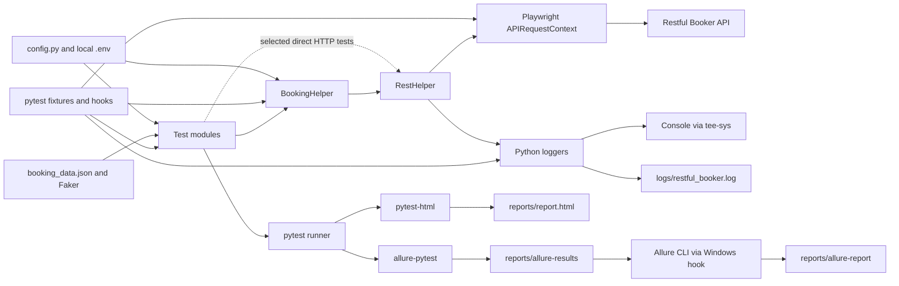

# Restful Booker API Automation Framework

Automated API validation for the Restful Booker service using pytest and
Playwright's synchronous `APIRequestContext`.

[](https://www.python.org/)
[](https://docs.pytest.org/en/stable/)
[](https://playwright.dev/python/)

> **Client implementation:** The repository uses Playwright Python
> `APIRequestContext`; it does not use the Python `requests` package.

## Table of Contents

- [Project Overview](#project-overview)
- [Key Features](#key-features)
- [Technology Stack](#technology-stack)
- [Project Architecture](#project-architecture)
- [Framework Architecture Diagram](#framework-architecture-diagram)
- [Framework Design and Implementation](#framework-design-and-implementation)
- [API Endpoints Covered](#api-endpoints-covered)
- [Test Coverage](#test-coverage)
- [Test Execution Results](#test-execution-results)
- [Installation and Setup](#installation-and-setup)
- [Environment Variables](#environment-variables)
- [Test Execution Commands](#test-execution-commands)
- [Logging and Reporting](#logging-and-reporting)
- [Test Execution Workflow](#test-execution-workflow)
- [CI/CD Integration](#cicd-integration)
- [Screenshots and Reports](#screenshots-and-reports)
- [Future Enhancements](#future-enhancements)
- [Author](#author)

## Project Overview

This project is a pytest-based automated test suite for the Restful Booker API.
It validates endpoint behavior through HTTP requests, checking response
statuses, response payloads, field types, and persisted booking state.

The suite contains **232 collected test instances**, including cases expanded
from parametrized tests. It covers authentication, booking CRUD operations,
input validation, negative cases, data integrity, and end-to-end workflows.

The HTTP client is Playwright's synchronous `APIRequestContext`, provided to
pytest through `pytest-playwright`. It is not Requests-based; `requests` is
neither declared in `requirements.txt` nor imported by the framework.

## Key Features

- Shared low-level HTTP execution and higher-level booking operations.
- Environment-based configuration for the service URL and authentication
  credentials.
- Token creation and authorization scenarios, including cookie-based tokens.
- Baseline JSON test data and dynamic values generated with Faker and Python's
  `random` module.
- Function-scoped pytest fixtures for request-context setup and disposal.
- Test-specific booking setup and cleanup fixtures.
- Parametrized tests for invalid input, boundary values, and header variations.
- Explicit assertions for status codes, response data, data types, and booking
  state.
- INFO-level console and file logging.
- pytest-html reporting with captured output and live console output.
- Allure result collection and a Windows-only post-session HTML generation
  attempt.
- Per-module test order values beginning at 1.

## Technology Stack

The versions below were verified in the local test environment. Dependencies
in `requirements.txt` are not version-pinned.

| Technology | Verified version | Purpose |
|---|---:|---|
| Python | 3.11.8 | Test and framework implementation |
| pytest | 9.0.3 | Test runner, fixtures, parametrization, assertions, and markers |
| Playwright Python | 1.64.1 | Synchronous HTTP requests through `APIRequestContext` |
| pytest-playwright | 0.10.0 | Provides the Playwright fixture to pytest |
| pytest-html | 4.2.0 | Self-contained HTML test report |
| allure-pytest | 2.16.2 | Allure result collection |
| Faker | 40.54.0 | Generated names and dates |
| python-dotenv | 1.2.4 | Loads configuration from a local `.env` file |
| pytest-order | 1.5.0 | Applies explicit test ordering |
| jsonschema | 4.26.0 | Declared dependency; current tests use explicit assertions and do not import it |
| JSON | Standard library | Booking payload storage and API data |
| Git / GitHub | N/A | Version control and repository hosting |

The Allure command-line application is separate from the `allure-pytest` Python
package and is not installed by `requirements.txt`.

## Project Architecture

```text
restful-booker-api-automation/
├── config/
│   └── config.py
├── test_data/
│   └── booking_data.json
├── tests/
│   ├── conftest.py
│   ├── test_auth.py
│   ├── test_create_booking.py
│   ├── test_delete_booking.py
│   ├── test_e2e_scenarios.py
│   ├── test_get_all_bookings.py
│   ├── test_get_booking_by_id.py
│   ├── test_partial_update_booking.py
│   ├── test_ping_check.py
│   └── test_update_booking.py
├── utils/
│   ├── booking_helper.py
│   ├── data_generator.py
│   ├── logger.py
│   └── rest_helper.py
├── .gitignore
├── pytest.ini
├── requirements.txt
└── README.md
```

The `.env` file is created locally and is not tracked. Test reports, Allure
output, logs, Python caches, and the virtual environment are generated or local
artifacts excluded by `.gitignore`.

| Path | Responsibility |
|---|---|
| `config/config.py` | Loads and validates required environment variables; defines endpoint URLs and ping response-time thresholds. |
| `test_data/booking_data.json` | Baseline booking request payload. |
| `tests/conftest.py` | Shared Playwright, REST-helper, and booking-helper fixtures; test lifecycle logging; Allure results setup and report-generation hook. |
| `tests/test_auth.py` | Credential validation, token handling, and authorization behavior. |
| `tests/test_create_booking.py` | Booking creation, payload validation, boundary values, headers, and tracked-record cleanup. |
| `tests/test_delete_booking.py` | Booking deletion, invalid IDs/tokens, and deletion integrity. |
| `tests/test_e2e_scenarios.py` | Multi-step booking, authorization, update, and deletion workflows. |
| `tests/test_get_all_bookings.py` | Booking collection retrieval and query-filter scenarios. |
| `tests/test_get_booking_by_id.py` | Single-booking retrieval, response shape/types, ID formats, headers, and authentication behavior. |
| `tests/test_partial_update_booking.py` | PATCH behavior and authenticated booking setup/cleanup. |
| `tests/test_ping_check.py` | Ping availability, repeated calls, response-time checks, and unsupported methods. |
| `tests/test_update_booking.py` | PUT behavior, authorization, payload edge cases, data integrity, and test-record cleanup. |
| `utils/booking_helper.py` | High-level authentication, collection, booking, and ping operations. |
| `utils/rest_helper.py` | HTTP-method dispatch, request/response logging, serialization, and JSON response parsing. |
| `utils/data_generator.py` | JSON file loading and generators for names, dates, prices, deposit values, and additional needs. |
| `utils/logger.py` | Named INFO-level loggers with console and file handlers. |
| `pytest.ini` | Test discovery, capture/report options, logging level, and registered markers. |
| `requirements.txt` | Python dependency list. |
| `.gitignore` | Excludes local environments, caches, reports, and logs. |

No GitHub Actions workflow or screenshot assets are currently tracked.

## Framework Architecture Diagram



Tests usually call `BookingHelper`; a small number of cases use `RestHelper`
directly for raw method or request behavior. Fixtures construct the helpers
around the Playwright request context. `allure-pytest` writes result files; the
post-session hook separately attempts to render the Allure report.

## Framework Design and Implementation

### Request and booking helpers

`RestHelper.execute` validates the HTTP method and endpoint, then dispatches
GET, POST, PUT, PATCH, DELETE, HEAD, or OPTIONS through Playwright's
`APIRequestContext`. It logs the request URL and body and the response status
and body. `parse_response_json` parses JSON object responses and raises a
descriptive error for invalid JSON or a non-object response.

`BookingHelper` provides reusable methods for creating tokens, listing booking
IDs with query parameters, retrieving bookings, creating bookings, performing
full and partial updates, deleting bookings, and checking `/ping`. It attaches
the token as a `Cookie: token=...` header for operations that accept a token.

### Fixtures and lifecycle

`tests/conftest.py` provides:

- `request_context`: creates a Playwright API request context per test and
  disposes it during teardown.
- `rest_helper`: creates the low-level request helper.
- `booking_helper`: creates the high-level booking helper.

Test modules define additional fixtures where setup or cleanup is needed. These
include tracking created bookings and fixtures that create an authenticated
booking before yielding it to a test. End-to-end scenarios include explicit
delete steps. Cleanup is test-specific rather than a single global cleanup
policy.

### Configuration and authentication

`config/config.py` loads variables from the process environment and `.env`
through `python-dotenv`. Import fails with an `EnvironmentError` if
`BASE_URL`, `BOOKER_USERNAME`, or `BOOKER_PASSWORD` is missing. Endpoint URLs
are constructed from `BASE_URL`.

Tests request a token from `POST /auth` using the configured credentials and
pass it in a cookie for authorized operations. The tests also exercise missing,
invalid, and alternate token placements.

### Test data, requests, and assertions

`test_data/booking_data.json` provides a baseline payload. Tests may use
`data_generator.py` to generate names, dates, prices, deposit flags, and
additional-needs values. The test suite uses explicit Python assertions for
status codes, response fields, types, and persisted state. Although
`jsonschema` is listed as a dependency, the current tests do not import it for
schema validation.

Parametrized tests reuse a test function across multiple input values. Test
markers are registered in `pytest.ini` for categories such as functional,
negative, security, authentication, authorization, schema, smoke, regression,
and endpoint-specific groups. Order numbering starts at 1 in each file.

## API Endpoints Covered

| Method | Endpoint | Purpose |
|---|---|---|
| POST | `/auth` | Validate credentials and create an authentication token. |
| GET | `/ping` | Check API availability. |
| GET | `/booking` | Retrieve booking IDs; tests exercise name and date query filters. |
| GET | `/booking/{id}` | Retrieve a booking by ID and validate data and response behavior. |
| POST | `/booking` | Create a booking from a JSON payload. |
| PUT | `/booking/{id}` | Replace booking data. |
| PATCH | `/booking/{id}` | Partially update booking data. |
| DELETE | `/booking/{id}` | Delete a booking. |

## Test Coverage

The **232 collected test instances** include both standalone and parametrized
cases. Implemented scenario categories include:

- **Positive testing:** valid authentication and booking operations.
- **Negative testing:** malformed payloads, missing fields, invalid IDs, and
  rejected credentials or tokens.
- **Boundary testing:** booking values, date formats, string lengths, and
  numeric values.
- **Security testing:** token placement and cookie variations, invalid
  authentication, and hostile filter/payload values.
- **Authentication and authorization:** valid, missing, and invalid tokens
  across protected operations.
- **CRUD operations:** create, retrieve, update, partially update, and delete
  bookings.
- **Data validation:** response fields and types, payload fields, and persisted
  booking state.
- **API chaining:** create a booking, use its ID in subsequent requests, then
  verify update or deletion effects.
- **End-to-end testing:** booking lifecycle and multi-booking workflows.
- **Data integrity:** ensure operations on one booking do not unintentionally
  affect another.
- **Performance and reliability:** repeated ping requests and a ten-request
  timing check against the configured P95 and maximum thresholds.

No category-wise test counts are reported because cases overlap categories and
parametrized functions expand into multiple collected instances.

## Test Execution Results

The latest recorded complete suite run collected **232 instances**:

| Result | Count |
|---|---:|
| Passed | 229 |
| Failed | 0 |
| Skipped | 0 |
| Expected failures (XFAIL) | 3 |
| **Total** | **232** |

The three strict XFAIL cases document behavior observed in the hosted demo API:
two unsupported `Accept` values on PUT return an error while the booking is
still changed, and a `bookingid` value in the PUT payload can return an error
while affecting stored records. These are **not counted as passed**. Strict
XFAIL makes a change in observed service behavior visible for review.

The full-suite result above was recorded before the later `--capture=tee-sys`
console-output configuration change. A focused delete test passed after that
configuration change; the full suite has not been rerun since then.

## Installation and Setup

### Prerequisites

- Python 3.11.8 was used for the verified run. The repository does not declare
  a minimum Python version.
- Git.
- Access to a Restful Booker API environment.

### Clone the repository and install dependencies

```powershell
git clone https://github.com/hellojanardhan/restful-booker-api-automation.git
Set-Location .\restful-booker-api-automation

python -m venv .venv
.\.venv\Scripts\Activate.ps1

python -m pip install --upgrade pip
python -m pip install -r requirements.txt
```

If PowerShell activation is restricted, use Command Prompt:

```bat
.venv\Scripts\activate.bat
```

The tested suite uses Playwright's API request context and does not launch a
browser.

## Environment Variables

Create a root-level `.env` file from this safe template. Replace the credential
placeholders privately; do not commit real credentials.

```dotenv
BASE_URL=https://restful-booker.herokuapp.com
BOOKER_USERNAME=replace_with_test_username
BOOKER_PASSWORD=replace_with_test_password
```

| Variable | Required | Purpose |
|---|---:|---|
| `BASE_URL` | Yes | Root URL used to construct API endpoint URLs. |
| `BOOKER_USERNAME` | Yes | Username passed to the authentication endpoint. |
| `BOOKER_PASSWORD` | Yes | Password passed to the authentication endpoint. |

The `.env` file is ignored by Git. There are no configurable API timeout or
retry environment variables in the current implementation. The API request
context uses Playwright defaults. The 120-second timeout in `conftest.py` is
only for the Allure report-generation subprocess.

## Test Execution Commands

Run commands from the repository root in PowerShell.

```powershell
# Complete suite; creates the configured HTML report and Allure results
python -m pytest

# Individual test module
python -m pytest .\tests\test_delete_booking.py

# Individual test case
python -m pytest .\tests\test_delete_booking.py::test_delete_booking_with_valid_token

# Marker-based execution
python -m pytest -m smoke
python -m pytest -m "functional and booking_by_id"

# Keyword-based execution
python -m pytest -k "invalid_id"

# Extra verbose output
python -m pytest -vv .\tests\test_delete_booking.py
```

The HTML report is generated automatically by the options in `pytest.ini`:
`reports/report.html`. Each test run replaces that configured report with the
results from that run, so a focused run produces a focused report.

## Logging and Reporting

### Logging

The named Python loggers use INFO level and the following format:

```text
YYYY-MM-DD HH:MM:SS | LEVEL | logger-name | message
```

`utils/logger.py` configures a console `StreamHandler` and a file handler at
`logs/restful_booker.log`. Logger propagation is disabled to avoid duplicate
output. Pytest's `--capture=tee-sys` setting streams captured output to the
console while preserving it for the HTML report.

**Sensitive-data warning:** `RestHelper` currently logs request and response
bodies without redaction. These bodies can contain credentials or tokens. Use
test-only credentials and inspect/redact logs and reports before sharing them.

### pytest-html

`pytest.ini` enables `pytest-html` with `--self-contained-html`. The report is
written to `reports/report.html`. Expand a test row in the report to inspect
captured output and failure tracebacks.

### Allure

`allure-pytest` writes result files to `reports/allure-results`. At session end,
`tests/conftest.py` attempts to run `allure.bat` through `cmd.exe` and generate
`reports/allure-report`. This hook is Windows-specific and requires the
separate Allure CLI on `PATH`. If the CLI is unavailable, the hook reports the
problem without preventing pytest-html report generation.

## Test Execution Workflow

1. Pytest reads `pytest.ini`, applies capture/report options, and discovers
   tests under `tests/`.
2. `config/config.py` loads and validates the environment variables.
3. Session setup prepares a clean `reports/allure-results` directory.
4. Function-scoped fixtures create a Playwright request context and construct
   `RestHelper` and `BookingHelper`.
5. Tests load baseline JSON, generate dynamic values where required, and issue
   API requests through the helpers.
6. The helpers log request and response details; tests assert status codes,
   response data, data types, and resulting booking state.
7. Test-specific teardown removes tracked bookings where cleanup is defined;
   the request context is disposed.
8. Pytest-html writes the captured run to `reports/report.html`. Allure results
   are collected, and the session hook attempts to render the Allure report.

## CI/CD Integration

No GitHub Actions workflow or other CI/CD configuration is currently tracked
in the repository. The suite is run locally with `python -m pytest`.

## Screenshots and Reports

No screenshot assets are currently committed. Capture genuine screenshots
from the generated report before adding image links here.

| Asset | Status |
|---|---|
| pytest-html report screenshot | Placeholder - add a real screenshot after capturing `reports/report.html`. |
| Test execution summary screenshot | Placeholder - add a real screenshot from an actual pytest run. |
| GitHub Actions workflow screenshot | Not applicable; no workflow is implemented. |

The HTML and Allure reports are generated outputs and are excluded from Git by
`.gitignore`.

## Future Enhancements

- Add a GitHub Actions workflow for pull-request validation and report
  publishing.
- Add explicit, configurable API request timeouts and retry policies.
- Redact credentials and tokens before writing request/response bodies to logs.
- Use the already-declared `jsonschema` dependency for reusable contract
  validation.
- Add parallel execution after test data and ordering are isolated from shared
  hosted-service state.
- Make Allure report generation configurable and portable across operating
  systems.

## Author

**hellojanardhan** · [GitHub profile](https://github.com/hellojanardhan)
